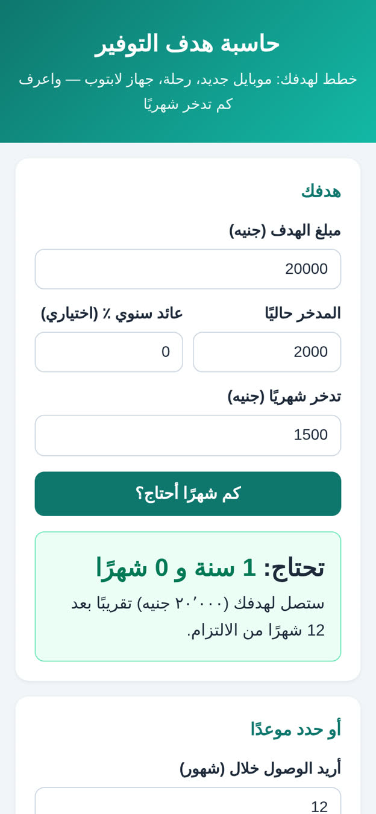

# Savings Goal Calculator | حاسبة هدف التوفير

Plan a savings goal: how many months you need, or how much to save monthly to arrive on a set date, with optional annual return. Arabic interface.

**Live app:** https://abood-ayman.github.io/savings-goal-ar/

This is a personal project, built with AI tools.

## Features
- How many months you need at your current monthly saving
- How much to save monthly to hit a target date
- Optional annual return (certificates or deposits) compounded monthly
- Table of the first year of growth, month by month

## Privacy
Everything runs in your browser. No data is stored or sent anywhere.

## Run locally
Open `index.html` in any browser. It is a single static page with no dependencies.

## Status
Stable.

## Copyright
MIT License - Copyright (c) 2026 Abdullah Ayman.
